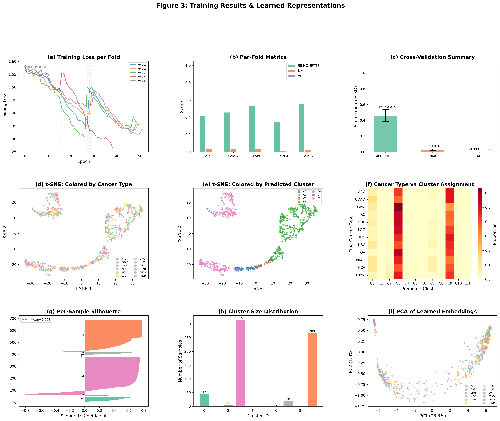

# HiOmicsFormer

A hierarchical multi-modal transformer framework for pan-cancer biomarker discovery and molecular subtype stratification.


## Overview

HiOmicsFormer integrates four omics modalities -- mRNA expression, miRNA expression, DNA methylation, and copy number variation -- from TCGA pan-cancer data to perform molecular subtype discovery and biomarker identification. The framework combines modality-specific transformer encoders, cross-omics supervised contrastive learning, gated multi-modal fusion, and deep embedded clustering to produce biologically interpretable subtypes across 12 cancer types.

This work accompanies the paper submitted to *Advances in Biomarker Sciences and Technology* (Elsevier/KeAi).

## Architecture



The framework consists of five main components:

1. **Hierarchical tokenization** -- Structures high-dimensional omics features into biologically informed token sequences.
2. **Modality-specific transformer encoders** -- Learns representations independently for each omics modality.
3. **Cross-omics supervised contrastive learning** -- Aligns representations across modalities using label-aware contrastive objectives.
4. **Gated multi-modal fusion** -- Adaptively combines modality-specific representations through learned gating mechanisms.
5. **Deep embedded clustering (DEC)** -- Jointly optimizes feature representations and cluster assignments.

## Key Results

| Metric | Value |
|--------|-------|
| Silhouette Score (5-fold CV) | 0.462 +/- 0.075 |
| Within-cancer Subtype Silhouette | 0.821 (mean across 12 types) |
| Multi-seed Stability (CV) | 8.2% |
| Biomarker Jaccard Stability (MICE vs Mean) | >= 0.79 |

## Dataset

This study uses data from 3,304 TCGA patients across 12 cancer types, accessed through the MLOmics repository.

Raw multi-omics data is not included in this repository due to size. See `data/DATA_ACCESS.md` for access instructions.

## Repository Structure

```
HiOmicsFormer/
├── README.md
├── LICENSE
├── CITATION.cff
├── requirements.txt
├── .gitignore
├── notebooks/
│   ├── HiOmicsFormer_Revised_R1_Final.ipynb
│   └── HiOmicsFormer_Revised_R1_Final.html
├── figures/
│   ├── fig1_dataset_overview.png
│   ├── fig2_preprocessing.png
│   ├── fig3_training_embeddings.png
│   ├── fig4_baseline_comparison.png
│   ├── fig5_biomarkers.png
│   ├── fig6_enrichment.png
│   ├── fig7_survival_analysis.png
│   ├── fig8_imputation_sensitivity.png
│   └── fig9_subanalysis.png
└── data/
    └── DATA_ACCESS.md
```

## Reproduction

1. Clone the repository:
   ```bash
   git clone https://github.com/Nadim-Mahmud-23/HiOmicsFormer.git
   cd HiOmicsFormer
   ```

2. Install dependencies:
   ```bash
   pip install -r requirements.txt
   ```

3. Download the data following the instructions in `data/DATA_ACCESS.md`.

4. Open and run the notebook:
   ```bash
   jupyter notebook notebooks/HiOmicsFormer_Revised_R1_Final.ipynb
   ```

A pre-rendered HTML version of the notebook with all outputs is available at `notebooks/HiOmicsFormer_Revised_R1_Final.html` for inspection without execution.

## Citation

```bibtex
@article{dipu2025hiomicsformer,
  title={HiOmicsFormer: A Hierarchical Multi-Modal Transformer Framework with Cross-Omics Contrastive Learning for Pan-Cancer Biomarker Discovery and Molecular Subtype Stratification},
  author={Dipu, Nadim Mahmud},
  journal={Advances in Biomarker Sciences and Technology},
  year={2025},
  note={Under review}
}
```

## License

This project is licensed under the MIT License. See [LICENSE](LICENSE) for details.

## Contact

Nadim Mahmud Dipu
Department of Computer Science and Engineering, Brac University, Dhaka, Bangladesh
Email: nadim.mahmud.dipu@g.bracu.ac.bd
